<div align="center">

# Nowhere

**A full-stack MERN clothing store with an AI shopping assistant that doesn't just answer, it shops.**

[](https://github.com/ibrahim123-sia/Nowhere/actions/workflows/ci.yml)
[](LICENSE)


[Features](#features) · [Nora](#meet-nora-the-ai-shopping-assistant) · [Screenshots](#screenshots) · [Quick start](#quick-start) · [Architecture](#architecture) · [API](#api-overview) · [Docs](#documentation)

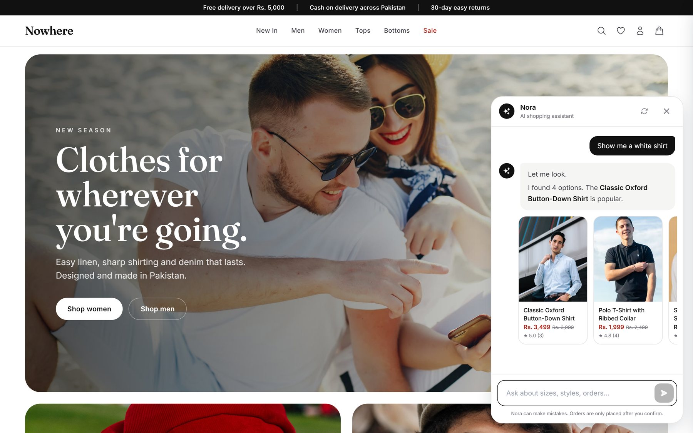

</div>

## Overview

**Nowhere** is a production-style e-commerce platform for a Pakistani clothing brand. A React 18 + Vite storefront talks to an Express and MongoDB API and covers the complete retail flow: a filterable catalogue with real product photography, reviews with fit feedback, guest and account carts, guest checkout with cash on delivery, order tracking and cancellation, transactional email, and an admin panel with a sales dashboard.

Its headline feature is **Nora**, an AI shopping agent built into every page. Nora runs on free LLM tiers (Groq or Google Gemini), and uses tools to search the catalogue, manage the bag, prepare an order summary and place a cash-on-delivery order once the shopper confirms, then track, cancel or re-order it. She works for guests and signed-in customers alike, in English, Urdu or Roman Urdu.

| | |
| --- | --- |
| **40** products with 80 matching photos | **13** agent tools, from search to order |
| **192** reviews with fit notes | **86** automated API and agent checks |
| **Guest checkout**, COD, promo codes | **0** known vulnerabilities in production dependencies |

## Features

| Area | Highlights |
| --- | --- |
| **Catalogue** | Editorial home page; filters for gender, category, size, colour, material, brand, price, stock and sale generated from live facets; removable filter chips; sorting; load more; live search suggestions |
| **Product pages** | Gallery with hover swap, real sale pricing, named colour swatches, size guide, stock status, delivery window, fabric and care details, share, similar and recently viewed products |
| **Reviews** | Rating breakdown, "runs small / true to size / runs large" fit meter, verified-buyer badges, one review per customer |
| **Checkout** | Guest checkout with email only, saved address for customers, promo codes (`WELCOME10`, `NOWHERE500`), shipping Rs. 250 or free over Rs. 5,000, every total computed on the server |
| **Orders** | Human-friendly order numbers, status timeline, cancel while processing, buy again, guest tracking by order number + email, confirmation emails |
| **Accounts** | JWT auth with email OTP verification, password reset, profile, saved address, password change, persistent wishlist |
| **Admin** | Revenue, average order value, orders by status, 30-day sales chart, low-stock alerts; one product form for add/edit; order workflow; user management |
| **Assistant** | Nora: streaming chat with product cards, order summaries with Confirm buttons and order-placed cards; server-enforced confirmation |

## Meet Nora, the AI shopping assistant

Nora is an agent: a language model that can call tools and loop until the shopper's request is done.

- **Find** products by style, colour, size, budget or occasion, and explain fabric, fit and reviews.
- **Act** on the bag: add, change quantity, remove, or re-add a past order.
- **Check out**: collect delivery details (or reuse the saved address), show a priced summary, and place a cash-on-delivery order after the shopper confirms.
- **Support**: track orders, cancel unshipped ones, and answer shipping, returns, sizing and promotion questions.

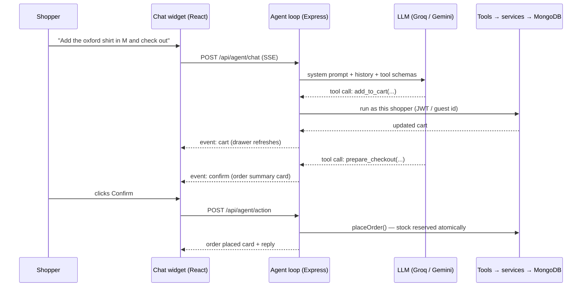

**Built to be safe**

- Tools always act as the requesting shopper; identity comes from the JWT or guest id, never from model output.
- Placing or cancelling an order is two-step: the server only confirms in a later message than the one that prepared it, and the Confirm button executes it without the model.
- Tool output (descriptions, reviews) is treated as data, not instructions; facts must come from tools.
- Rate limits, message length limits, per-session turn limits and one reply at a time per conversation.

**Free providers, one code path.** Groq and Gemini both expose OpenAI-compatible chat completions, so a single `fetch` + server-sent-events parser supports both, plus any compatible endpoint. If one provider is rate limited, the next configured one takes over.

| Provider | Key | Default model |
| --- | --- | --- |
| Groq | [console.groq.com/keys](https://console.groq.com/keys) | `llama-3.3-70b-versatile` |
| Google Gemini | [aistudio.google.com/apikey](https://aistudio.google.com/apikey) | `gemini-2.5-flash` |
| Custom (OpenRouter, Ollama, ...) | `AGENT_BASE_URL` + `AGENT_API_KEY` | `AGENT_MODEL` |

## Screenshots

| Storefront | Product |
| --- | --- |
| 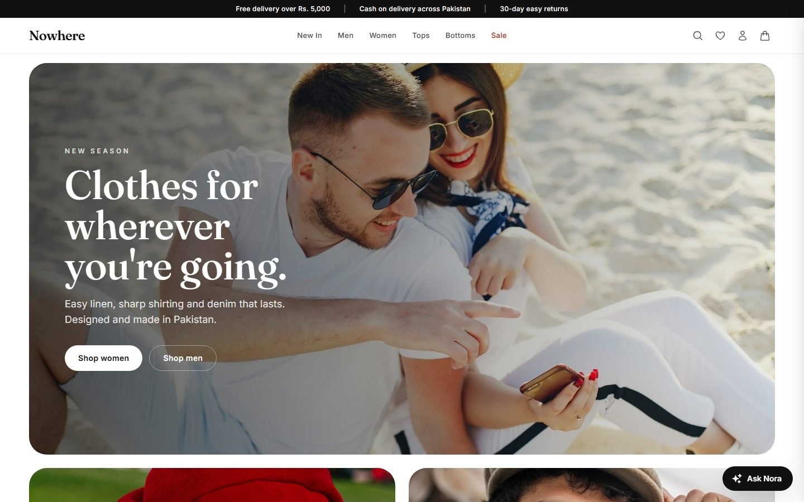 | 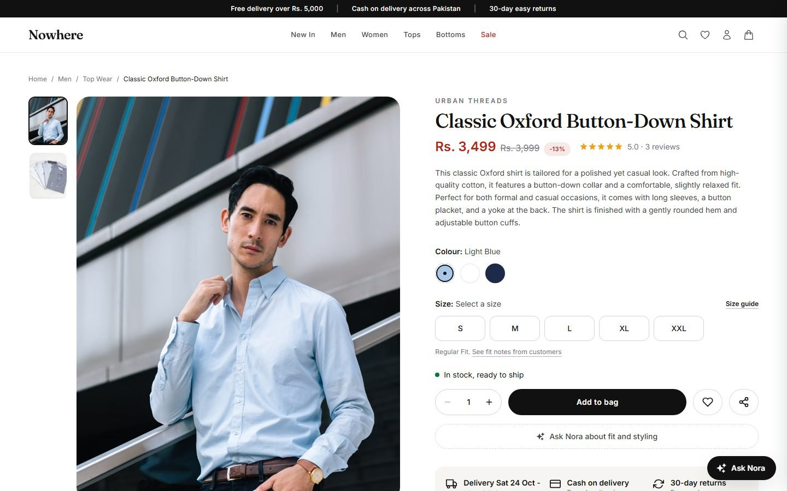 |
| **Collection filters** | **Guest checkout** |
| 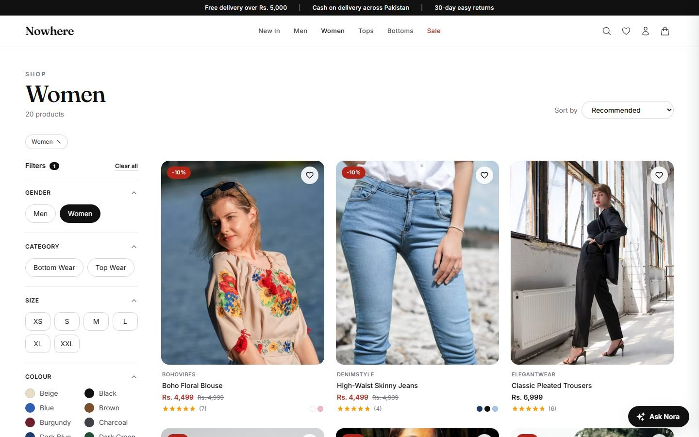 | 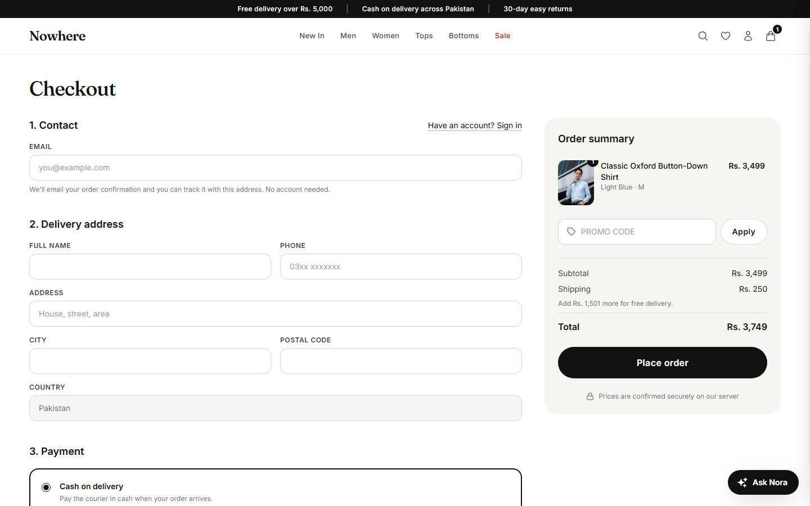 |
| **Nora prepares the order** | **Order placed from chat** |
| 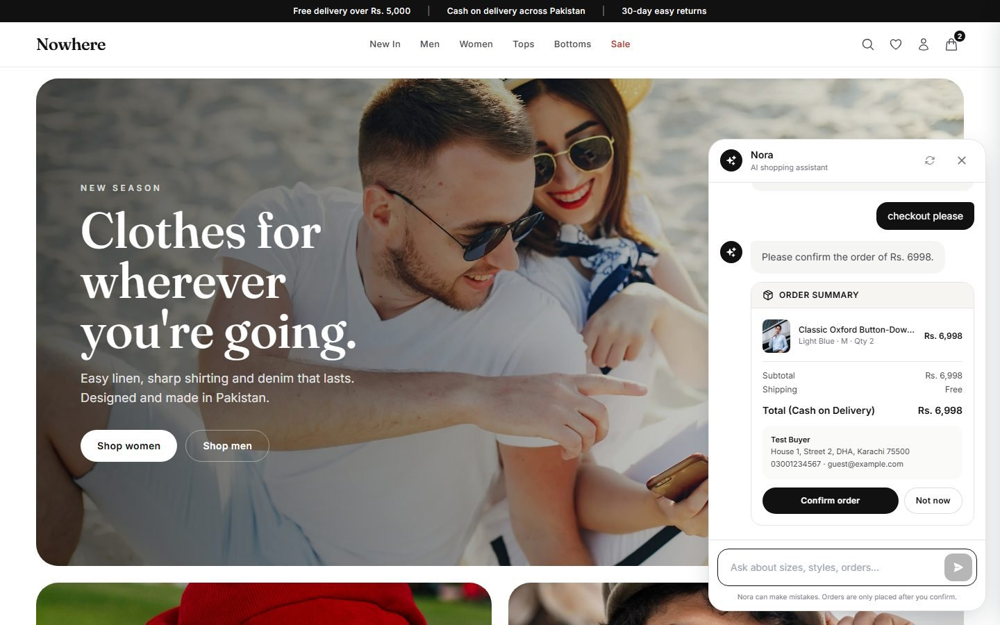 | 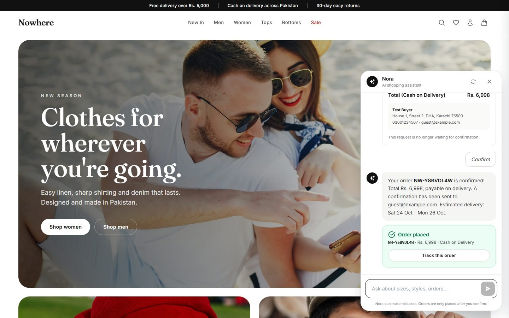 |
| **Admin dashboard** | **Order management** |
| 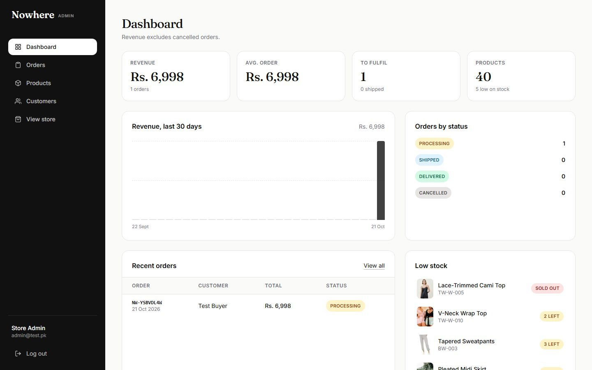 | 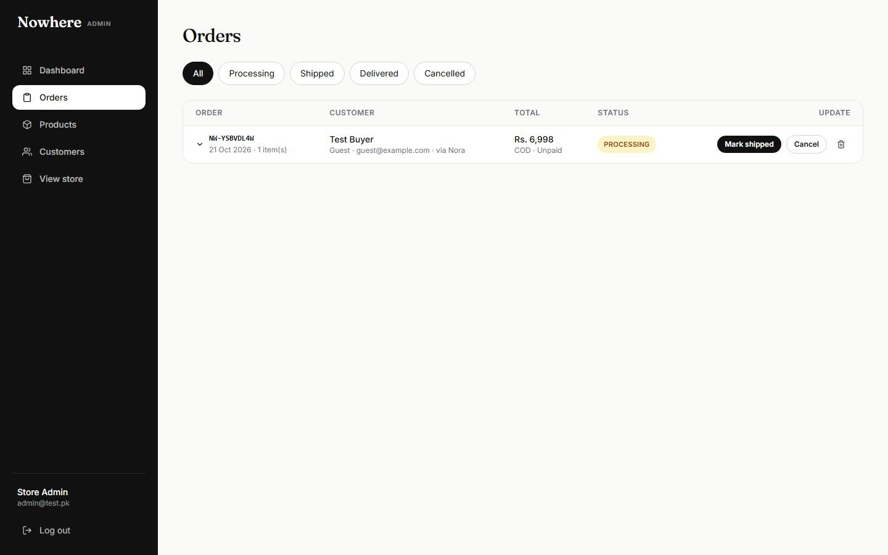 |

## Tech stack

| Layer | Technologies |
| --- | --- |
| Frontend | React 18, Vite 6, Redux Toolkit, React Router 7, Axios, Tailwind CSS 3, React Icons, Sonner |
| Backend | Node.js, Express 4, Mongoose 8, JSON Web Tokens, bcryptjs, Nodemailer, Multer + Cloudinary, express-rate-limit, helmet |
| AI | Groq or Google Gemini via OpenAI-compatible chat completions, native `fetch`, server-sent events |
| Data | MongoDB Atlas |
| Quality | ESLint, end-to-end API tests with mongodb-memory-server and a mock LLM, GitHub Actions CI |

## Architecture

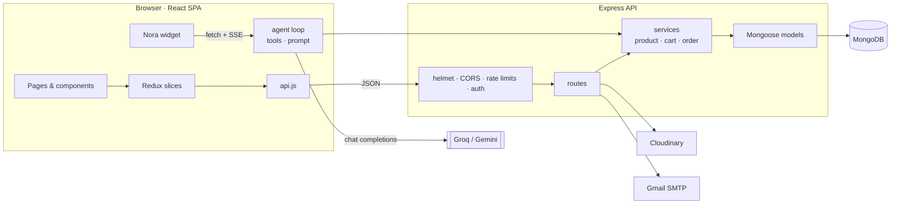

- **Thin routes, shared services.** Pricing, stock and ownership rules live in `backend/services`, so the REST API and the agent's tools can't drift apart.
- **The server decides identity and prices.** Cart owners come from the JWT or guest id; totals, shipping and coupons are always recomputed.
- **Atomic stock.** Orders reserve stock with a conditional `$inc`, so the last item can't be sold twice; cancellations return it.
- **Aggregation-based search.** Filters and sorting use the effective (sale) price, and filter values come from the published catalogue.

## Quick start

**Prerequisites:** Node.js 20+, a MongoDB database, and optionally Cloudinary, a Gmail app password and a free Groq or Gemini key.

```bash
git clone https://github.com/ibrahim123-sia/Nowhere.git
cd Nowhere
npm run install:all

cp backend/.env.example backend/.env      # fill in your values
cp frontend/.env.example frontend/.env

npm run seed        # optional: sample catalogue on a fresh database
npm run dev:api     # API  → http://localhost:9000
npm run dev:web     # Shop → http://localhost:5173
```

Without an AI key the store works normally and the chat shows that the assistant is offline.

### Scripts

| Command (from the repo root) | Description |
| --- | --- |
| `npm run install:all` | Install backend and frontend dependencies |
| `npm run dev:api` / `npm run dev:web` | Run the API (nodemon) / the storefront (Vite) |
| `npm run build` | Production build of the storefront |
| `npm run lint` | Lint the storefront |
| `npm test` | API and assistant test suite |
| `npm run seed` | Fresh database: sample products, reviews and a verified admin |
| `npm run enhance` | Upgrade an existing catalogue in place by SKU (add `-- --dry` to preview) |

Neither data script deletes users or orders.

### Environment variables

| Variable | Required | Description |
| --- | --- | --- |
| `MONGODB_URI` | Yes | MongoDB connection string |
| `JWT_SECRET` | Yes | Secret for signing tokens |
| `CLIENT_URL` | Production | Allowed frontend origin(s), comma separated |
| `CLOUDINARY_CLOUD_NAME` / `_API_KEY` / `_API_SECRET` | For uploads | Product image storage |
| `EMAIL_USER` / `EMAIL_PASS` | For email | Gmail address and app password |
| `AGENT_PROVIDER` | No | `groq` (default), `gemini` or `custom` |
| `GROQ_API_KEY` / `GEMINI_API_KEY` | For Nora | Free API keys; set both for automatic fallback |
| `GROQ_MODEL` / `GEMINI_MODEL` | No | Override the default models |
| `ADMIN_NAME` / `ADMIN_EMAIL` / `ADMIN_PASSWORD` | For `seed` | Admin account created on a fresh database |
| `VITE_BACKEND_URL` | Yes (frontend) | API origin used by the storefront |

The full list with comments is in [`backend/.env.example`](backend/.env.example).

## API overview

Base path `/api`. "Guest or user" routes accept an optional JWT and otherwise identify the shopper by `guestId`.

| Area | Endpoints | Access |
| --- | --- | --- |
| Auth | `POST /users/register`, `/verify-otp`, `/resend-otp`, `/login`, `/forgot-password`, `/reset-password` · `GET/PUT /users/profile` | Public · User |
| Catalogue | `GET /products`, `/products/facets`, `/suggest`, `/best-sellers`, `/new-arrivals`, `/products/:id`, `/similar/:id` | Public |
| Reviews | `GET /products/:id/reviews` · `POST /products/:id/reviews` | Public · User |
| Cart | `GET/POST/PUT/DELETE /cart` · `POST /cart/merge`, `/cart/reorder` | Guest or user · User |
| Checkout | `POST /checkout/quote` · `POST /checkout` | Guest or user |
| Orders | `GET /orders/my-orders`, `/orders/:id` · `PUT /orders/:id/cancel` · `POST /orders/track` | User · Public |
| Assistant | `POST /agent/chat` (SSE) · `POST /agent/action` · `GET/DELETE /agent/session/:id` · `GET /agent/status` | Guest or user |
| Store | `GET /store/config` · `POST /subscribe` · `POST /contact` | Public |
| Admin | `/products` (write) · `/admin/users` · `/admin/products` · `/admin/orders` · `/admin/orders/stats` · `POST /upload` | Admin |

Request and response details are in the [project overview](docs/Nowhere-Project-Overview.pdf).

## Testing

```bash
npm test
```

The suite starts the real Express app against an in-memory MongoDB and a mock OpenAI-compatible LLM that streams scripted tool calls. Its 86 checks cover search and filters, cart validation, guest and customer checkout, coupons, stock reservation and release, order privacy, the OTP flow, admin rules, reviews, the contact form, and the assistant: streaming, product and confirmation cards, the server-side confirmation gate, the Confirm button path, session privacy and provider errors. CI runs the suite, the linter and a production build on every push.

## Deployment

Both apps include a `vercel.json`. Deploy `backend/` as a Node project and `frontend/` as a static Vite project, then:

1. Set the backend environment variables, including `CLIENT_URL` (the storefront origin) and at least one AI key.
2. Set `VITE_BACKEND_URL` on the frontend to the API origin.
3. On an existing database, run `npm run enhance` once to upgrade the catalogue; on a new one, run `npm run seed`.
4. Sign in as the admin and change the default password.

## Project structure

```
Nowhere/
├── .github/workflows/   CI: backend tests, frontend lint and build
├── backend/
│   ├── agent/           AI assistant: provider client, tools, prompt, agent loop
│   ├── config/          database connection, store settings (shipping, coupons, policies)
│   ├── data/            sample products and reviews
│   ├── middleware/      auth (protect · optional · admin), error handling
│   ├── models/          User, Product, Review, Cart, Order, Subscriber, AgentSession
│   ├── routes/          REST routes, assistant and admin routes
│   ├── scripts/         in-place catalogue upgrade
│   ├── services/        product, cart and order logic shared by routes and the agent
│   ├── tests/           end-to-end API and assistant tests
│   └── utils/           mailer, errors, text helpers
├── frontend/
│   └── src/
│       ├── components/  Layout, Product, Cart, Order, Agent, Admin, Common
│       ├── Pages/       route-level pages
│       ├── redux/       store and slices
│       ├── hooks/
│       └── utils/       API client, pricing and order helpers
├── docs/                project overview and learning guide (PDF), screenshots
├── LICENSE
└── package.json         root scripts for both apps
```

## Security

- Cart and order ownership is enforced on the server; orders are visible only to their owner or an admin.
- Prices, shipping, discounts and stock are validated and computed server-side.
- Passwords are hashed with bcrypt and never returned; OTPs are hashed, time-limited and attempt-limited.
- Rate limits on authentication, checkout, tracking, contact and the assistant.
- helmet security headers, a CORS allowlist, JSON body limits, regex-safe search and admin-only uploads with type and size limits.

## Roadmap

- Online payments (JazzCash, Easypaisa or cards) alongside cash on delivery
- Stock per size and colour
- Returns and exchanges from the order page and through Nora
- Customer photos in reviews; shipping notifications by email or WhatsApp

## Documentation

| Document | Contents |
| --- | --- |
| [Project overview (PDF)](docs/Nowhere-Project-Overview.pdf) | Product summary, screens, architecture, data model, API reference, audit findings, competitive comparison, deployment |
| [Learning guide (PDF)](docs/Nowhere-Learning-Guide.pdf) | How the code works end to end, with a deep dive into how the AI agent is built, kept safe and extended |

## Author

**Syed Ibrahim Ali** · Full-Stack & AI Engineer · [GitHub](https://github.com/ibrahim123-sia)

## License

Released under the [MIT License](LICENSE).
